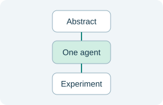
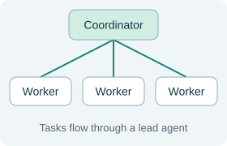
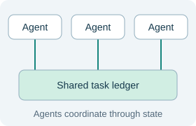
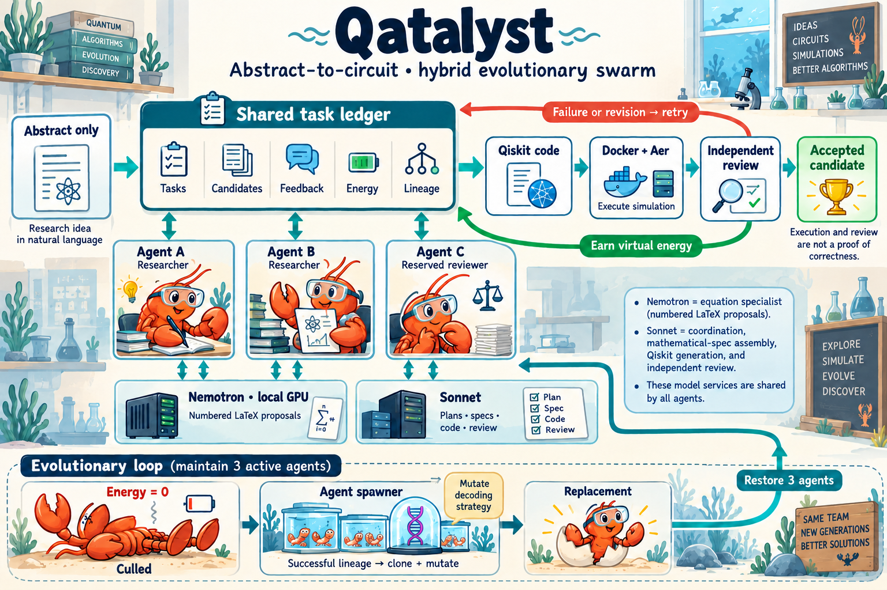
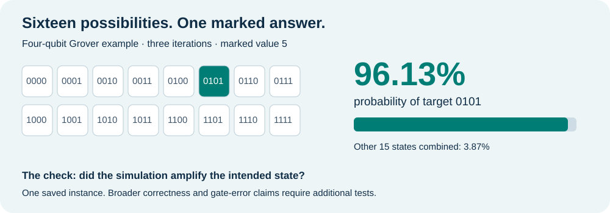

# Qatalyst: can a team of AI agents turn an abstract into an experiment?

From one researcher to a shared scientific workspace: what we learned about AI teams, simulation, and the search for algorithms.

**MIT Science Hackathon · 5 min read**

**Team:** Sanjay Das, Ethan Seefried, Chris Kellogg, Tahisha Jain, Nafiza Shazia Aviedi

## Start with a paragraph, end with a test

A scientific abstract is a promise in miniature. It describes what a method can do, but leaves much of the work between the idea and the experiment unstated. For the MIT Science Hackathon, we built Qatalyst to explore that missing middle: give AI agents only a quantum-computing abstract, then ask them to propose equations, write Qiskit code, and test a circuit in simulation. The larger question is simple: how should we organize AI researchers so their ideas become evidence?

## One researcher—or a team?

Imagine reconstructing a recipe from its description. One cook can plan every step and prepare the dish. A head chef can divide the work among assistants. Or cooks can choose tasks from a shared board, compare attempts, and build on one another’s work. AI systems have similar choices. “Multi-agent” means several agents participate; “centralized” and “decentralized” describe how they coordinate. More agents bring more possible approaches, along with more communication and cost.

## A shared ledger turns ideas into a survival game

Qatalyst explores coordination through a shared scientific notebook: a ledger of tasks, candidate methods, test results, feedback, energy, and lineage. The historical ledger swarm used workers bidding on dependent contracts. The newer native hybrid adds an energy-based lifecycle around candidate development and review. Think of energy as a limited opportunity to keep searching. In the hybrid, progress rewards are deferred until a candidate executes and passes agent review. An agent that exhausts its energy can be retired and replaced, within run limits. A replacement varies a successful donor’s strategy when one is available; otherwise it explores afresh. This is virtual search bookkeeping, separate from API spending and software crashes.

## What happens inside an attempt

The hybrid maintains three logical agents: two can develop implementations, while one stays outside their implementation chains to review. A fine-tuned NVIDIA Nemotron Bolt model proposes numbered equations locally. Sonnet plans methods, assembles specifications, generates code, and reviews candidates. Code builds in Docker and runs in Qiskit Aer; failures and criticism feed the next revision. Work is coordinated through shared state, but the ledger, model services, and GPU are shared on one host. This is not a fully distributed system. Our Sonnet-only experiments also test a single agent, a ledger swarm, and an Abstract2Method search swarm.

Native hybrid architecture from the project repository. Click to open the full-resolution diagram.

## A concrete example: finding one answer among sixteen

Picture sixteen cards, with one marked 0101. A four-qubit Grover circuit aims to amplify the chance of measuring that card. In one saved hybrid run, the generated circuit assigned 96.13% of its simulated probability to 0101 after three iterations. The attempt took 156 seconds and about $0.25 in estimated paid API usage. A separate affine-rule pilot recovered both hidden components of f(x) = a·x ⊕ b in 28 of 28 small parameter instances, under explicit oracle assumptions. These examples show what a testable reconstruction looks like; they do not establish the source papers’ full claims or novel algorithm discovery.

One saved four-qubit simulation, not a general algorithm-correctness score. Values from the supplied November 1 report.

## The result: teams help some things, not everything

The completed Sonnet comparison tells a more useful story than “more agents win.” On the same 84 papers, the single agent recovered the most matching main equations and had the lowest total estimated API cost. Across the full 96-paper cohort, Abstract2Method produced more circuits that reached simulation—93 versus 77—but cost about 8.2 times as much. The newer hybrid snapshot had 15 reviewed-ready outcomes among 21 completed papers out of 65 planned. Its selected equations retained no native proposals verbatim, so Nemotron’s incremental benefit remains unestablished. Execution, equation matching, and agent approval are different measures; independent correctness checks remain essential.

| Configuration | Equations matched / 320 | Simulated / 96 | Est. API total |
| --- | --- | --- | --- |
| Single Sonnet | 54 | 77 | $7.52 |
| Ledger swarm | 26 | 48 | $13.67 |
| Abstract2Method | 46 | 93 | $61.97 |

Math recovery: matched 84-paper cohort. Simulation: full 96-paper cohort. Costs: saved calls across each experiment; estimates, not invoices.

## Domain transfer: from quantum circuits to materials science

Can the same abstract-to-experiment loop work for atomic structures? We tested it on an unseen basin-hopping paper about Lennard-Jones clusters: finding low-energy arrangements of atoms by turning a rugged energy landscape into a staircase of local minima. Agents received the abstract and a Python execution contract; the full paper and hidden checks stayed with the evaluator.

A sequential agent and a three-agent decentralized swarm used the same fine-tuned Nemotron Bolt checkpoint, seed, tests, and search-budget ceilings. Each used 10 model calls and about 26,000 search tokens on one GPU with serialized generation. The swarm recorded three energy deaths and three replacements, but its initial agents proposed identical reconstructions.

Both systems passed 0 of 3 public-plus-hidden cases: a Python NameError stopped execution before usable atomic coordinates were returned. The result locates an implementation/runtime integration gap; physical-method accuracy remains unestablished. This one-paper, one-seed pilot shows how the workflow can be exercised in another domain, not successful scientific transfer or a swarm advantage. The next step is to repair the interface, rerun independent numerical checks, and broaden the evaluation.

## From reconstruction toward discovery

Our mission at SI² is to connect scientific reasoning with experimentation and discovery. Qatalyst makes that connection visible: an idea becomes a candidate, a candidate meets a test, and the evidence informs the next attempt. The next steps are stronger functional checks, completed cohorts, repeated budget-matched comparisons, and ablations that isolate each model’s contribution. Beyond reconstruction, we want to test whether this loop can generate useful new algorithmic variations. That ambition depends on better evidence, not simply a larger swarm. Bring a scientific question, a rigorous test, or an engineering improvement—and help us build the next experiment.

## Team and support

Built by Sanjay Das, Ethan Seefried, Chris Kellogg, Tahisha Jain, and Nafiza Shazia Aviedi. The project used NVIDIA ALCHEMI, Sonnet, and fine-tuned NVIDIA Nemotron Bolt; Claude and GPT Sol supported the build. We thank Claude for $100 in API support for building the project, separate from reported experiment-cost estimates. The quantum report does not isolate ALCHEMI’s performance contribution.

[Source code](https://github.com/eseefried/Algo-Discovery-Sim) · [Architecture](https://github.com/eseefried/Algo-Discovery-Sim/blob/main/docs/architecture.md)

*Results snapshot: November 1, 2026, 11:21:52 a.m. EST. Based on the team-supplied algo-sim-REPORT.md. Native and hybrid batches are partial; reported readiness is execution plus agent review. The current evidence does not establish novel discovery, an evolutionary advantage, or full-paper reproduction.*
